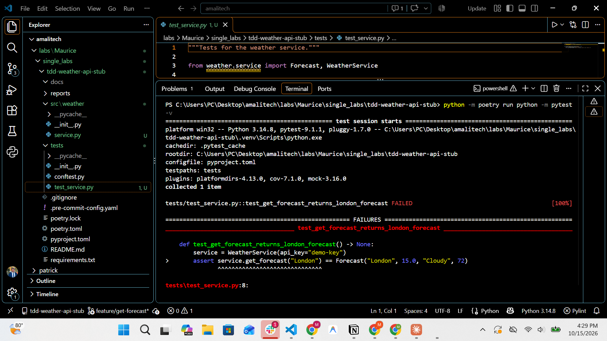
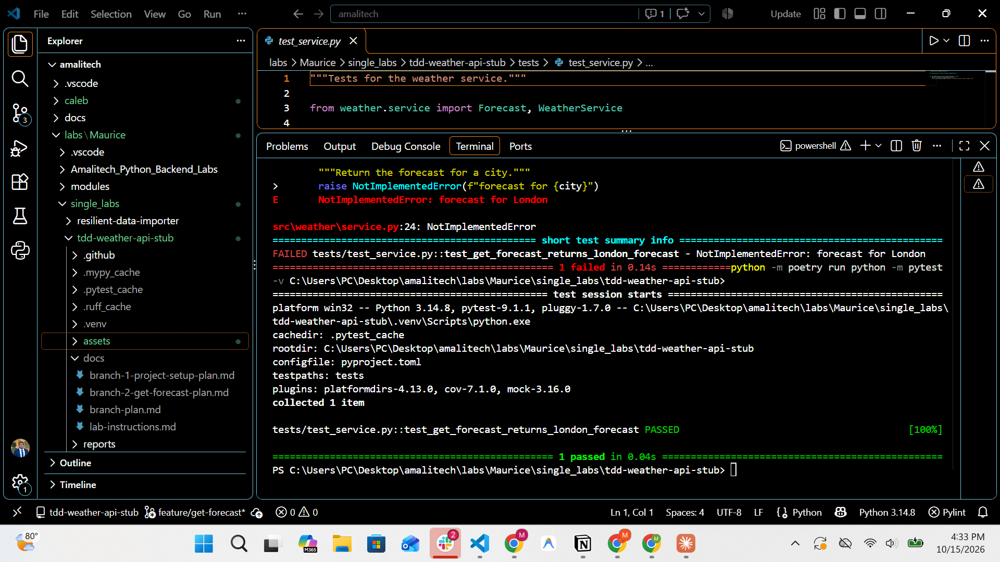
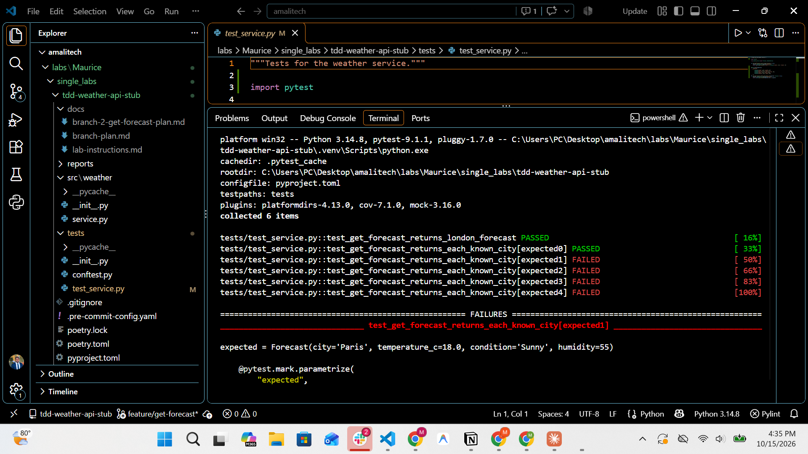
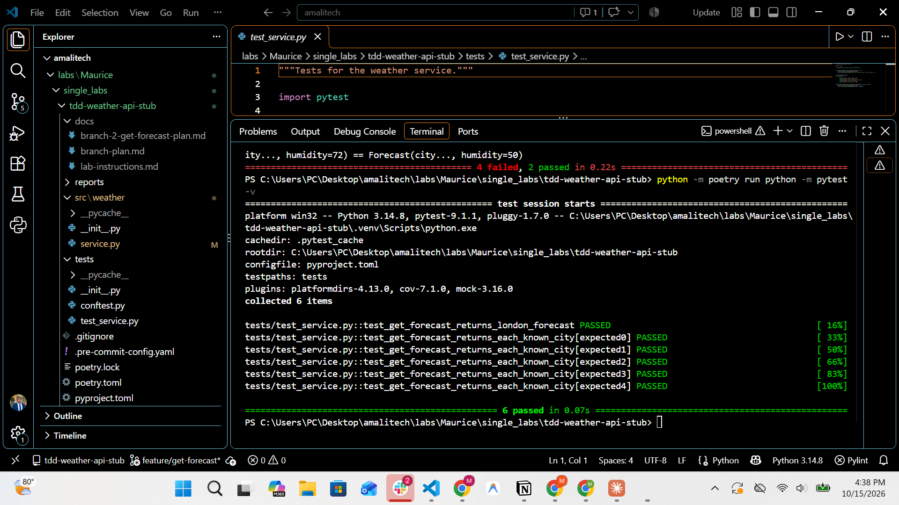
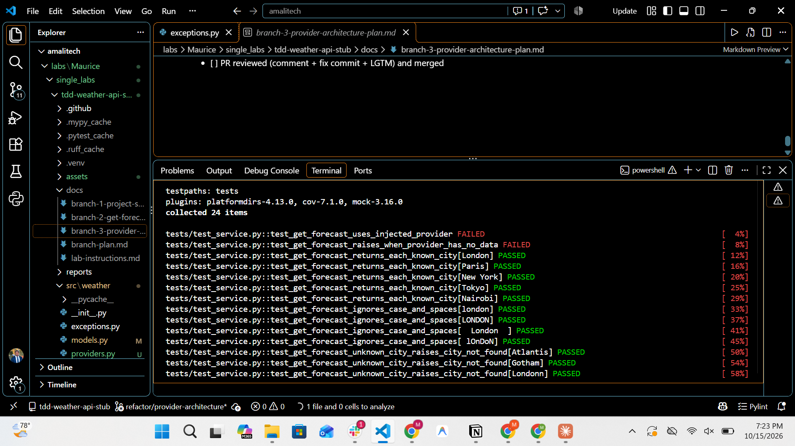
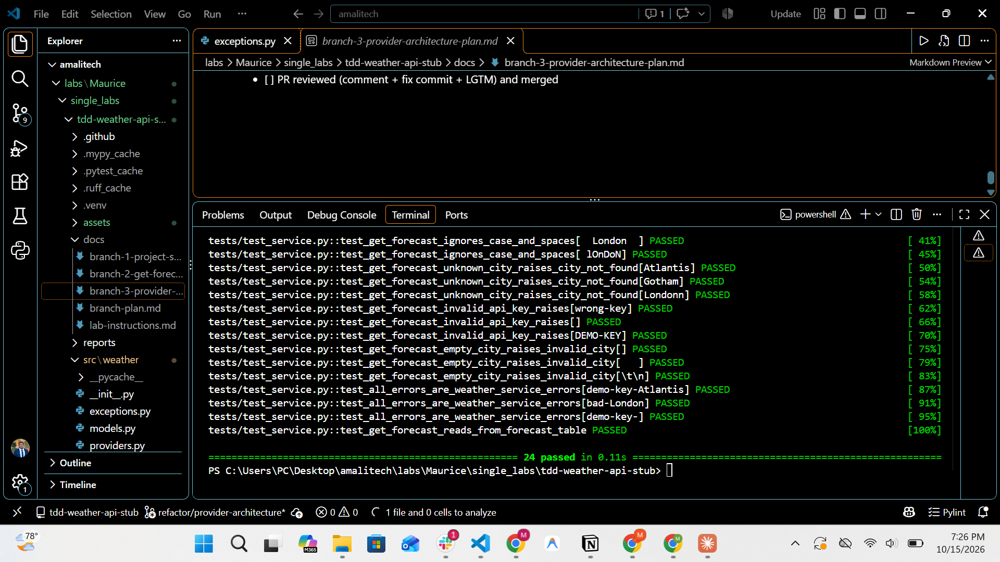
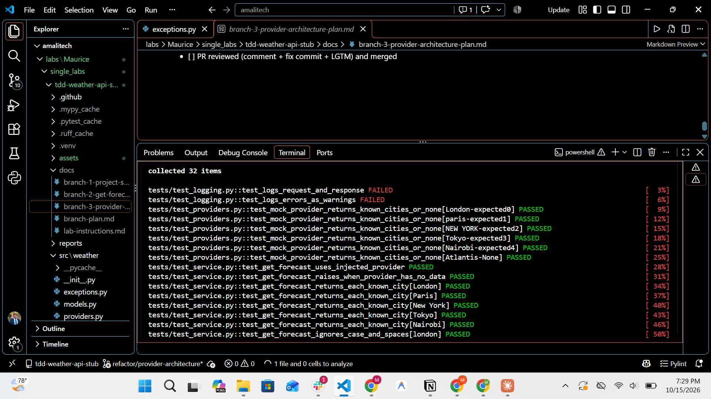
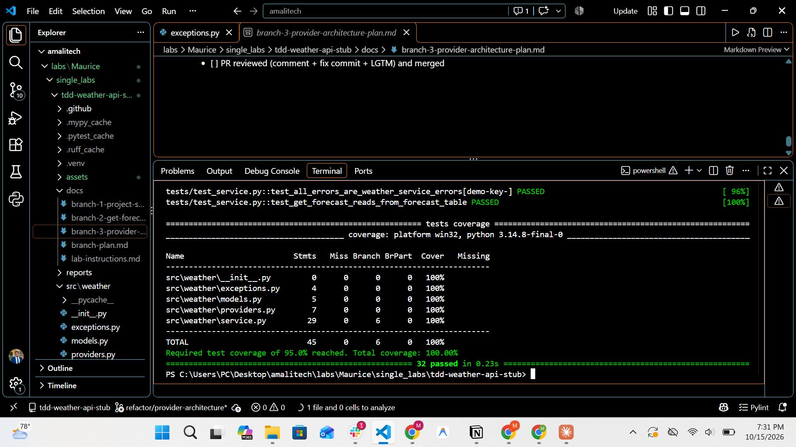

# TDD Weather API Stub

A mock **Weather API service** in Python, built with strict **Test-Driven Development**
(red → green → refactor). It does not call a real API: it returns predefined forecasts
for known cities and clear errors for invalid input.


---

## Features

- `get_forecast(city)` returns a `Forecast` for **London, Paris, New York, Tokyo, Nairobi**
- City names are matched ignoring letter case and surrounding spaces
- Custom errors: `InvalidAPIKeyError`, `InvalidCityError`, `CityNotFoundError`
  (all inherit from `WeatherServiceError`)
- Structured logging of every request, response and error
- Data comes from a swappable `WeatherProvider` (mock today, real API later)

## Setup

```bash
git clone https://github.com/Molyceo12/TDD-Based-API-Service-Stub.git
cd TDD-Based-API-Service-Stub
python -m pip install poetry          # if Poetry is not installed
python -m poetry install
python -m poetry run python -m pre_commit install
```

Without Poetry: `python -m pip install -r requirements.txt` then `python -m pip install -e .`

## Usage

```python
from weather.services import WeatherService

service = WeatherService("demo-key")         # valid keys: "demo-key", "test-key"
service.get_forecast("London")
# Forecast(city='London', temperature_c=15.0, condition='Cloudy', humidity=72)

service.get_forecast("  paris ")             # Paris forecast (case/spaces ignored)
service.get_forecast("Atlantis")             # CityNotFoundError: City not found: Atlantis
service.get_forecast("")                     # InvalidCityError
WeatherService("wrong").get_forecast("London")   # InvalidAPIKeyError
```

Try it from the terminal:

```bash
python -m poetry run python -c "from weather.services import WeatherService; print(WeatherService('demo-key').get_forecast('Tokyo'))"
```

Or run the demo, which prints sample forecasts and every error type as a table
(the service's log lines are hidden there):

```bash
python -m poetry run python examples/demo.py
```

Output:

```
+-------------+---------------+-----------------------------------------------+
| API key     | City          | Result                                        |
+-------------+---------------+-----------------------------------------------+
| 'demo-key'  | 'London'      | London, 15.0 C, Cloudy, 72%                   |
| 'demo-key'  | '  nEw YoRk ' | New York, 22.0 C, Partly cloudy, 60%          |
| 'test-key'  | 'Tokyo'       | Tokyo, 26.0 C, Rainy, 80%                     |
| 'demo-key'  | 'Atlantis'    | CityNotFoundError: City not found: Atlantis   |
| 'demo-key'  | 'Londonn'     | CityNotFoundError: City not found: Londonn    |
| 'demo-key'  | ''            | InvalidCityError: City name must not be empty |
| 'demo-key'  | '   '         | InvalidCityError: City name must not be empty |
| 'wrong-key' | 'London'      | InvalidAPIKeyError: Invalid API key           |
| 'DEMO-KEY'  | 'Paris'       | InvalidAPIKeyError: Invalid API key           |
+-------------+---------------+-----------------------------------------------+
```

Log lines (`key=value` style):

```
INFO     weather.services.weather_service  request city=London
INFO     weather.services.weather_service  response city=London condition=Cloudy temperature_c=15.0
WARNING  weather.services.weather_service  error city=Atlantis reason=City not found: Atlantis
```

## Architecture

```
            your code
                │  get_forecast("London")
                ▼
        ┌────────────────┐   checks API key + city, logs, raises errors
        │ WeatherService │
        └───────┬────────┘
                │  fetch(ForecastRequest("London"))
                ▼
      ┌────────────────────┐   interface (ABC): any data source
      │  WeatherProvider   │
      └─────────┬──────────┘
                ▼
      ┌────────────────────┐   predefined table of 5 cities
      │ MockWeatherProvider│   (a real API provider could replace it)
      └────────────────────┘
```

```
src/weather/
├── exceptions.py              # WeatherServiceError and its 3 subclasses
├── models/
│   └── forecast.py            # Forecast (response) and ForecastRequest (request)
├── providers/
│   ├── base.py                # WeatherProvider interface
│   └── mock_provider.py       # MockWeatherProvider and its 5 known cities
├── services/
│   └── weather_service.py     # WeatherService (checks, logging, uses a provider)
└── utils/
    └── validation.py          # API key check and city name clean-up
tests/
├── conftest.py                # shared service fixture
└── unit/                      # one test file per part
examples/
└── demo.py                    # prints sample results as a table
```

**SOLID:** the service depends on the `WeatherProvider` abstraction (Dependency
Inversion), receives it through its constructor (Dependency Injection), and each module
has one job (Single Responsibility).

## TDD process

Every feature was built in the same cycle:

1. 🔴 **Red**: write a test for the new behaviour and watch it fail
2. 🟢 **Green**: write the minimum code to make it pass
3. 🔵 **Refactor**: clean the code while all tests stay green

The commit history shows the cycle (`test: ... (red)` → `feat: ... (green)` → `refactor: ...`):

| Cycle | 🔴 Red | 🟢 Green | 🔵 Refactor |
|---|---|---|---|
| London forecast | test: get_forecast returns London forecast | feat: return predefined London forecast | — |
| Known cities | test: every known city returns its own forecast | feat: add predefined forecasts for known cities | refactor: add service fixture and name test cases by city |
| Case/spaces | test: get_forecast ignores case and extra spaces | feat: ignore case and extra spaces in city names | — |
| Unknown city | test: unknown city raises CityNotFoundError | feat: raise CityNotFoundError for unknown cities | — |
| API key | test: invalid API key raises InvalidAPIKeyError | feat: check API key before returning a forecast | — |
| Empty city | test: empty or blank city raises InvalidCityError | feat: validate city input | — |
| Error base | test: all service errors share WeatherServiceError base | feat: make service errors inherit from WeatherServiceError | refactor: move models and exceptions into their own modules |
| Provider | test: service gets forecasts from an injected provider | feat: get forecasts from an injected provider | — |
| Mock provider | test: mock provider returns known cities and None | feat: move the forecast table into MockWeatherProvider | — |
| Logging | test: requests, responses and errors are logged | feat: log requests, responses and errors | refactor: reuse the Atlantis test forecast |

Red commits contain the failing test plus only an empty stub, so pre-commit (mypy) still
passes while the test fails for the right reason (the feature is missing).

### Screenshots

| 🔴 Red | 🟢 Green |
|---|---|
|  |  |
|  |  |
|  |  |
|  |  |

More: [refactor step](assets/tdd/05-fixture-refactor.png),
[case/spaces red](assets/tdd/06-case-spaces-red.png).

## Testing

```bash
python -m poetry run python -m pytest -v
python -m poetry run python -m pytest --cov --cov-report=term-missing
```

**37 tests, 100% line and branch coverage** (fails below 95%), see
[`reports/coverage.txt`](reports/coverage.txt).

| Test file | Covers | pytest features |
|---|---|---|
| `unit/test_service.py` | forecasts, errors, injected provider | fixture, `parametrize`, `pytest.raises`, `pytest-mock` |
| `unit/test_providers.py` | mock provider data | `parametrize` |
| `unit/test_logging.py` | request/response/error logs | `caplog` |
| `unit/test_validation.py` | API key check and city clean-up | `parametrize` |

The `service` fixture in `tests/conftest.py` gives every test a ready client.

## Code quality

Black, ruff, pylint and mypy (strict) run on every commit through pre-commit:

```bash
python -m poetry run python -m pre_commit run --all-files
```

All classes and methods have Google-style docstrings and type hints.

## Git workflow

Trunk-based development: short-lived branches from `main`, merged back through pull requests.

| PR | Branch | Content |
|---|---|---|
| #1 | `chore/project-setup` | tooling, pre-commit, PR template |
| #2 | `feature/get-forecast` | forecasts and errors (TDD) |
| #3 | `refactor/provider-architecture` | provider interface, logging (TDD) |
| #4 | `docs/coverage-and-readme` | README, coverage report, screenshots |

Branch 4 started from `main` before PR #3 and both changed the first line of
`service.py`; the resulting **merge conflict was resolved** in
`merge: resolve conflict with provider architecture`. The release is tagged `v1.0.0`.
